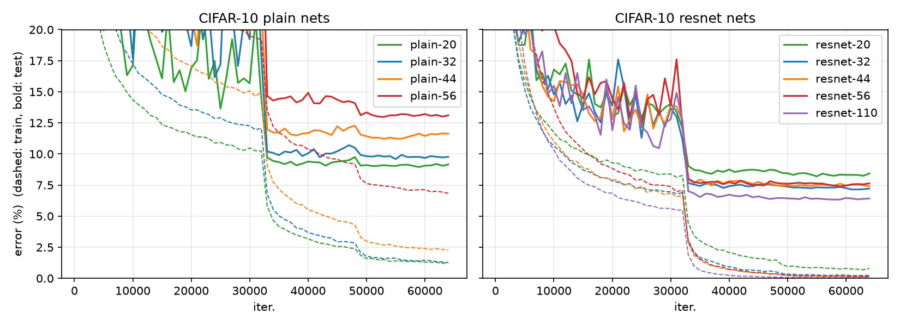

# ResNet — paper-to-code

A from-scratch PyTorch implementation of **Deep Residual Learning for Image
Recognition** (He, Zhang, Ren, Sun — CVPR 2016,
[arXiv:1512.03385](https://arxiv.org/abs/1512.03385)), with the CIFAR-10
experiments of Sec. 4.2 reproduced.

* Residual and plain networks for CIFAR-10 (6n+2 layers) and ImageNet
  (ResNet-18/34/50/101/152), with shortcut options A / B / C.
* Architectures are checked against the paper by tests (ImageNet FLOPs of
  Table 1, CIFAR-10 parameter counts).
* CIFAR-10 training follows the paper's protocol; ImageNet training and
  evaluation code is included but **not run** (see [Scope](#scope)).

## Results (CIFAR-10, Sec. 4.2)

Test error (%) at the last iteration (64k), single run, seed 0, full 50k
training set, no checkpoint selection. Paper numbers are the best of 5 runs
(Table 6), so they are an optimistic reference.

| depth | params | plain (ours) | ResNet (ours) | ResNet (paper) |
|---|---|---|---|---|
| 20 | 0.27M | 9.16 | 8.43 | 8.75 |
| 32 | 0.46M | 9.77 | 7.22 | 7.51 |
| 44 | 0.66M | 11.62 | 7.41 | 7.17 |
| 56 | 0.85M | 13.11 | 7.64 | 6.97 |
| 110 | 1.73M | – | 6.42 | 6.43 |



The behaviour of Fig. 6 is reproduced: plain nets get worse with depth, and
the *training* error of plain-56 is higher than that of plain-20 (dashed),
so this is an optimization problem and not overfitting; the residual nets
do not show it. Individual numbers differ from the paper by up to ~0.7
points, which is within what one would expect from a single seed.
Raw logs are in `results/cifar10/`.

## Usage

```bash
pip install -r requirements.txt
pytest                                   # architecture checks against the paper

python train_cifar.py --depth 56         # residual
python train_cifar.py --depth 56 --plain # plain counterpart
bash scripts/run_cifar_experiments.sh    # all of the above (~3 h on an RTX 4070 SUPER)
python scripts/plot_cifar.py             # figure + table

python train_imagenet.py --data /path/to/imagenet --depth 50 --accum-steps 4
python eval_imagenet.py  --data /path/to/imagenet --depth 50 --weights final.pt --mode multi-scale
```

## Layout

```
resnet/blocks.py          BasicBlock, Bottleneck, shortcut A/B/C        (Sec. 3.2, 4.1)
resnet/cifar.py           CIFAR-10 6n+2 networks                        (Sec. 4.2)
resnet/imagenet.py        ResNet-18/34/50/101/152                       (Table 1)
resnet/init.py            weight initialization                         (Sec. 3.4)
resnet/cifar_data.py      CIFAR-10 pipeline                             (Sec. 4.2)
resnet/imagenet_data.py   ImageNet augmentation and test transforms     (Sec. 3.4, 4.1)
resnet/schedule.py        CIFAR-10 LR schedule with warm-up
train_cifar.py  train_imagenet.py  eval_imagenet.py
tests/                    unit tests
docs/implementation_notes.md   paper → code map and every choice the paper leaves open
```

## Scope

* **Reproduced:** Fig. 6 (plain vs. residual, 20–56 layers) and the ResNet-110
  result of Sec. 4.2, with one seed.
* **Not reproduced:** ImageNet results (Tables 3–5), ResNet-1202, multiple
  seeds, and the shortcut A/B/C comparison. The ImageNet code is covered by
  unit tests and a smoke test on synthetic data, but a full run (~120 epochs)
  was out of reach on a single consumer GPU.
* Differences from the paper, e.g. single GPU and choices left open by the
  text, are listed in [docs/implementation_notes.md](docs/implementation_notes.md).

## Citation

```bibtex
@inproceedings{he2016deep,
  title     = {Deep Residual Learning for Image Recognition},
  author    = {He, Kaiming and Zhang, Xiangyu and Ren, Shaoqing and Sun, Jian},
  booktitle = {CVPR},
  year      = {2016}
}
```
